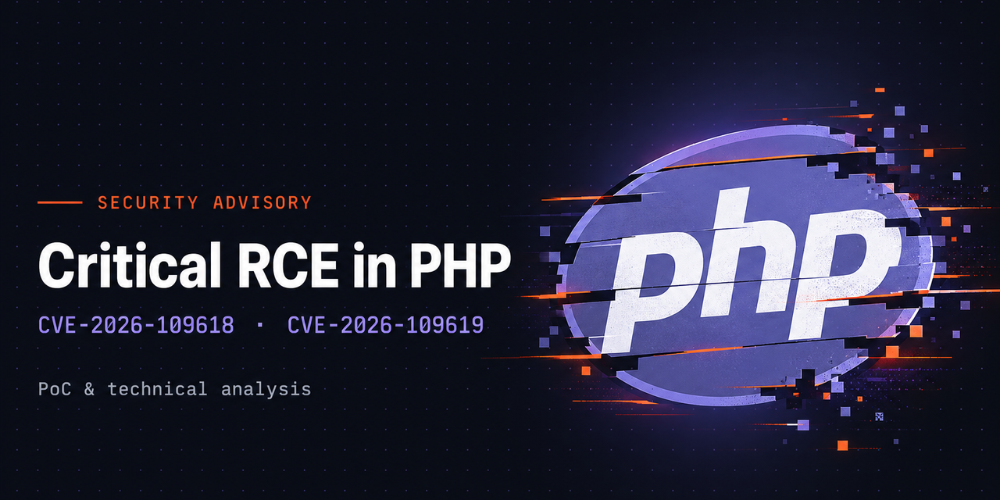

# php2shell



Exploit lab and read-only on-host audit for **CVE-2026-109618 / CVE-2026-109619**,
two unauthenticated RCEs in the PHP engine itself.

| | |
|---|---|
| `CVE-2026-109618` | RCE via OOM-handling corruption during multipart parsing |
| `CVE-2026-109619` | RCE via stale request-owned global state surviving heap free |
| Severity | CVSS 4.0 **9.2**, pre-auth |
| Advisories | `GHSA-w8hw-w9fx-j79w`, `GHSA-6wmf-4rv5-p3rp` |

> **Authorized use only.** The lab targets are containers bound to
> `127.0.0.1`. The audit script is read-only and sends no exploit traffic.

## Why the audit exists

There is no reliable external scanner for this. You will find vendors claiming
their DAST, WAF or "PHP vulnerability detection" product catches it; for this
bug class that claim does not hold up. The corruption happens in request
parsing, before application code and before any response the application
controls. There is no version banner to fingerprint, no payload reflection to
observe, and no stable error signature to match. A black-box scanner can only
guess.

The only dependable answer comes from inside the host: find the PHP runtime
that *actually serves requests*, and check whether it contains the fix.

```bash
sudo ./audit/audit-host.sh              # human-readable report
sudo ./audit/audit-host.sh --json       # machine-readable, for aggregation
```

It is read-only: it starts nothing, writes nothing, sends no exploit payload,
never triggers an OOM. Safe on production. Note that `php -v` alone is not
enough: distro backports, panel patches and un-restarted workers all produce a
version number that lies. The script checks the binary, the package changelog,
the live FastCGI worker and `/proc/*/maps`.

Verdicts, coverage and mitigation detail: [audit/README.md](audit/README.md).

## The exploit lab

A working chain against pinned PHP 8.4.26: proof the bugs are real, and a
reproducible target for testing detection and mitigation.

| Path | What it is |
|---|---|
| `php-session-uaf/` | The exploit chain (`sessionshell.py`) and its README |
| `wordpress/` | Stock WordPress 7.1.3 on pinned PHP 8.4.26 |
| `laravel/` | Stock Laravel 11 on pinned PHP 8.4.26 |
| `audit/` | `audit-host.sh`, read-only on-host detection |
| `HANDBOOK.md` | Operator handbook: run steps, caveats, troubleshooting |

```bash
cd wordpress && docker compose up -d
cd ../php-session-uaf && python3 sessionshell.py -u http://127.0.0.1:8091/
```

With no `-c`, the exploit stages its own trigger, starts its own listener,
fires the chain, and drops you into a shell as `www-data`. That is the full
claim. The CVE provides code execution as the web user, and no
privilege-escalation step is included or installed.

The targets are `127.0.0.1:8091` (WordPress) and `127.0.0.1:8090` (Laravel),
pinned by image digest for reproducible builds. The single-worker prefork
requirement and Laravel's `--huge-mb` calibration are in `HANDBOOK.md`.

## Credits

The core ASLR-bypass chain is **9bie's**
([php2shell-bypass-aslr-exp](https://github.com/9bie/php2shell-bypass-aslr-exp));
`php-session-uaf/` is derived from it and extended with URL/container
auto-resolution, automatic trigger staging, and a built-in interactive
listener. The audit script and the lab targets are original work. Details in
[php-session-uaf/README.md](php-session-uaf/README.md).

## License

MIT. See [LICENSE](LICENSE). Covers the lab targets, Dockerfiles, the audit
script, documentation, and the local additions to the exploit. It does **not**
re-license the derived chain in `php-session-uaf/`, whose core technique
remains the upstream author's work under their own terms.

## Reporting

Vulnerabilities in PHP itself go to the PHP project, not here — this repo
documents already-published CVEs. Bugs in the audit script or the lab
containers are welcome as issues. See [SECURITY.md](SECURITY.md) for the full
policy, supported versions, and scope.
